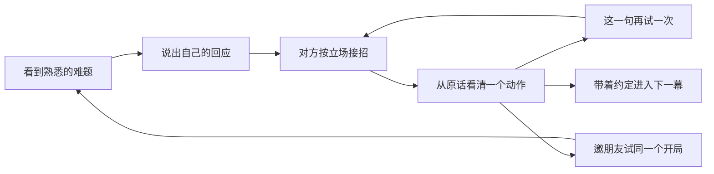

<!-- Last reviewed: 2026-10-22 -->

# SocialCoach：让人愿意再练，也愿意邀朋友来练

**建议：把“这句话你怎么接？”做成下一阶段的产品体验。先完成一个关键回合的短练与重试，再接同题邀请；验证后，把一个已有 3D 场景做成有行动后果的连续故事。** 判断信心中等：现有能力足够复用，具体需求与传播效果仍缺真人证据。

2026-10-22，用户要求关闭每周自动提案，并深入思考现有功能、回访和传播。自动任务 `socialcoach` 已成功删除。本文件是策略评审，候选尚未转成开发排期。此前一次晚间发布授权不扩大为长期自动开发或发布。

承接 [Stage E](../13-stage-e.md) 与[初始持续迭代计划](../archive/specs/spec-continuous-improvement.md)。每周自动执行已停止；产品方向继续按证据推进。

## 1. 已有资产与真实缺口

本轮先 fetch 并核对远端。初始主线为 `cc04496`，期间更新为 `b0b1525`，已补读新增的历史计划归档与推广入口记录，应用代码未再变化。本轮开始时原目录在 `a7ea838` 且有未提交工作，实现判断使用主线源码；期间其他工作将原目录同步到 `b0b1525` 并整理了历史文件。本任务没有切换、重置或清理原工作树，最终在最新目录新增本评审并更新自动提案的关闭状态。

| 已有资产 | 核对结果 | 下一步连接什么 |
|---|---|---|
| 58 个文字场景、自定义排练、语音、目标与阻力 | 最新 roadmap 已列出 | 让新用户快速遇到一个具体、想回答的冲突 |
| 证据复盘、独立重练原话对照、跨场模式与成长记录 | 原话对照有 10-12 双站发布及公开页面记录 | 把“我看懂了”接成“我现在再试这一句” |
| 图片分享、复制短文、系统分享 | `SharePractice.tsx` 已实现；当前短文和图片渲染没有产品链接、同题入口或二维码 | 把表达练习经历接成朋友可以参与的动作 |
| 多个 3D 空间、人物、十开局、视频入口 | 已有相当多的场景与资产 | 精修一组人物和一条故事的重玩理由 |
| 可靠性与复盘核对 | 10-22 的 #35–#37 已进入主线，最新记录为 101 项 core + 256 项 dinner、构建通过 | 真人流程中的等待、失败重试与评价公正性仍要观察 |
| 反馈与统计 | 飞书用户身份读取返回 `authentication/token_missing`；未取得当前反馈表或匿名事件 | 当前没有可报告的完成率、七日再练或分享转化基线 |

**工程交付与用户效果分别判断。** 10-22 的真实模型验收采用虚构输入，保留了复盘首次失败、重试，以及英文反思/追问仍失败的样本；这支持继续跟踪质量，不能据此估算线上失败率。最新修订的主线合并与本地验收已确认，本轮未核实其双站实际生产版本。

来源：[功能索引](../01-project-roadmap.md)、[原话对照发布](./review-2026-10-12-practice-comparison.md)、[分享实现](../../app/src/lib/share-card.ts)、[真实模型验收](../../docs/reviews/live-workflow-2026-10-22/README.md)、[成本与失败原件](../../docs/reviews/prompt-cost-2026-10-22/README.md)。源码基线：[b0b1525](https://github.com/GeminiLight/SocialCoach/tree/b0b15250b17197564a800891907292760c73d4a0)。

## 2. 三种回来的理由

SocialCoach 首先服务“有场难谈对话”的人。对话结束后暂时离开可能是正常节奏。长期价值可以体现在下一次遇到类似压力时，用户首先想到回来排练。

可以建立三种动机：

1. **当下想再试。** 刚才被追问后让了步，知道自己想换哪一句，也能立即试。
2. **之后想再来。** 记得一个熟悉角色、上次的约定和未解决的问题，愿意体验后续。
3. **想让别人试。** 一个有共鸣的开场，让朋友产生“换我会怎么说”的好奇。

产品假设是：具体情境、行动后果和可见的回应差异，能把现有训练功能连成可重复体验。当前没有数据证明这三种动机已经成立。

## 3. 三个方向的比较

| 方向 | 用户问题与证据 | 最小范围及定位契合 | 粗估投入、维护与模型成本 | 验收重点 |
|---|---|---|---|---|
| **A：这一句，重来（优先）** | 整场重练已有，关键回合短练尚未交付；降低再练成本的价值是假设，缺主动重练数据 | 一个文字单 NPC 场景，一处明确冲突，2–4 次用户回应，练一个动作；复用原话与复盘能力 | 约 5–8 个开发/验证工作日；前情快照、分支身份和证据范围维护中等。每次重试新增 NPC 与核对调用，短流程不保证金额更低 | 理解前情、愿意自主重试、能指出两次回应差异；失败保留原记录 |
| **B：同题邀练** | 分享卡已有但缺接收方可参与的入口，代码证据强；分享意愿与传播效果未知 | 一道公共虚构题、固定版本与开场、预览后分享图片/链接；朋友直达身份与目标说明并开练 | 约 3–5 日，含跨入口验证；链接版本与失效回退维护较低。卡片无新增模型成本，接收方练习产生调用 | 接收方抵达同题并完成练习；复制成功与菜单打开不计真实转发 |
| **C：一组人物，三幕故事** | 多空间、多角色及行动后果已有基础，跨幕后果与回访价值待验证 | 一个已有 3D 职场空间、固定人物、三幕；保留当前虚构故事内有证据的约定与分歧 | 约 2–3 周；内容、状态一致性、模型盲测与手机性能维护较高。每幕新增练习与核对成本 | 不同回应带来可解释的后续条件；主动进入第二幕，能说清前次行动的影响 |

投入是范围估计，尚未进行实施拆解，不是交付承诺。A 延续 E3，C 延续 E4，B 衔接 E5 与现有分享功能。候选保留在本报告，未重复追加 backlog 或功能 spec。

## 4. A：让一次失败成为想再试的时刻

以已有“同事临时让你接活”的场景为起点。以下是**本次原创虚构交互设计**，不是用户反馈或已发生的模型对话，也不是新增语料。

对方提出临时请求，用户拒绝后受到追问。复盘先展示用户实际说过的一句，再明确本次只练“说清自己能接什么、不能接什么”。用户选择“再试这一句”，看到必要前情，重新回应；对方按既有利益和事实继续接招。

满足感来自“我换了一种表达，对方真的作出了不同回应”。对方依然可以不接受。用户可以完成澄清、守住边界或修复关系，即使目标结果仍是部分成功。

最小边界：

- 先支持一个受控关键点，不做任意历史回合的通用倒带器。开练前清楚展示保留的已知事实和约定。
- 分支只取该时点之前的内容，后续才揭示的底牌不提前进入玩家简报；原场记录完整保留。
- 短练形成独立分支。它与完整场次的条件不同，不直接进入现有 E2 全场评级对比或成长算法；可展示两句原话与有证据的单项观察。
- 初期完成时长目标约 2–3 分钟，包含模型等待后实测，再决定是否这样对外描述。
- 引文核对、失败恢复以及拒绝/反问/玩笑/让步/修复/续聊六类行动仍须验收。重复尝试不保证 NPC 最终让步。

如果现有整场重练已足够便捷，或真正阻碍来自等待、评价不可信，A 应缩小或延期，先解决对应阻碍。

## 5. B：分享的理由是朋友也有一句想接的话

先分享**公共题目与开场**。例如一张卡提出“大家都愿意帮忙，为什么就你不行？”并邀请“换你会怎么回？”；朋友打开后知道自己的身份、目标、对方立场，开始自己的独立练习。此示意为原创虚构设计，成为语料前需补齐 source 并审阅。

卡片可复用已有 3D 画面、人物和公共台词，接收方先走轻量文字入口。既有视频也可在具体冲突处接同题练习，先验证一条内容。产品最有辨识度的画面帮助引起兴趣，入口负责让人开始回答。

待验证的传播路径是：公共冲突引发好奇 → 自己回答 → 发现应对差异 → 邀朋友回答。朋友面对的是同版本开局，后续生成可能不同，不能宣称严格同难度竞技。

边界与实现取舍：

- 链接只携带受控公共题目 ID、版本、语言和模式，不携带私人排练、原话、联系人或本地档案 ID。
- 私人原话默认关闭；主动添加时沿用预览与编辑，发送由用户决定。
- 复用现有分享组件，增加实际可达的链接/二维码与失效退路；不需要好友账号或云端练习存储。
- 验证一题后，可从已审核语料选职场、关系、家庭各一题轮换；不依赖每日自动生成新内容。

**入口是先决条件。** 最新 backlog 已记录分流与参数待复核。本轮对统一域名的一次 HEAD 请求携带 `utm_source=strategy-review&utm_campaign=20261022`，收到 302，`Location` 为 `https://socialcoach-ai.vercel.app/`，未保留这两个参数。这是单环境 HTTP 观察，不代表所有浏览器或国内链路，但要求上线前验证同题信息穿过分流、首次引导与 ModelScope 嵌入后仍能抵达正确场景。参见[推广承接待办](../85-backlog.md#推广承接与渠道统计10-12-观察10-22-整理)。

## 6. C：角色记得这段故事里的事

选择一个办公室空间做三幕：临时请求 → 根据前幕结果进入交接 → 在新的明确情境里处理后果。用户从未答应接活，第二幕就不能凭空把任务归给用户；只是提议、尚未接受，就保留分歧；约定已达成，才讨论其落实情况。

角色保持稳定利益与口吻，压力不必持续升级。可以有合作、有限让步、修复，以及用户主动结束。下一幕的吸引力来自“我想看看刚才的处理带来了什么”。高潮应是用户还能回应的决定。

只在设备上保存这条虚构故事的状态，关键事实可回到原话，支持重开、导出、清除。角色的故事记忆与现实私人资料分开。先把一组人物写得让人记住，随后再评估新地图与资产。

长期另一个候选是**“我的下一次开口”**：用户自愿给现实对话记下准备目标，回来后记“说了/没说/卡在哪”，再选择练习。它贴合事件驱动的回访，但属于现实自述，不自动转成技能提升证明。取得需求证据后再选择，不并行启动。

## 7. 分阶段推进与停止条件

以下按验收推进，不恢复自动执行。

| 阶段 | 交付/验证 | 继续或调整的判断 |
|---|---|---|
| 0：找到真实阻碍 | 观察约 8 位目标用户完成现有路径，区分首次/熟悉产品，记录开始、等待、复盘理解和自主再练 | 若多数人先卡在等待、报告失败或评价误读，先收口该环节；缺样本时可用可点击方案验证理解，不宣称留存改善 |
| 1：一句短练 | A 的一个场景、一个关键点、一次可选重试 | 探索门槛：8 人中至少 6 人无需解释就理解练什么，至少 4 人主动重试且能描述回应差异。未达到先找原因，不扩大题库 |
| 2：同题邀请 | B 的一题卡片、正确直达、接收者独立练习；验证后再扩到三题 | 观察约 5 组朋友；至少 3 组双方完成并能讨论回应差异，再优化传播。“有意思”或截图量不足以证明有效 |
| 3：三幕故事 | C 的一个空间、同组人物、最小状态集 | 观察主动进入下一幕及跨日回来；若用户只关心自己的真实排练，保留短练与事件回访，暂停故事扩张 |

人数与门槛是预先设定的探索决策规则，尚未实测，不是统计显著性或行业基准。样本少时给原始观察，不算提升百分比。招募与对外传播本轮均未执行。

**最可能推翻推荐的证据：** 真人观察显示大家能理解复盘，却因等待或错误评价而不愿再来。此时首要任务变成可预期地交付一次可信练习。另一反证是用户只愿按真实处境排练，对公共题和剧情没有兴趣；投入应转向真实场景校正与事件回访。

## 8. 结果、成本和验证口径

当前事件支持开始/结束/复盘及部分 3D 阶段，没有同题分享、接收入口或短练分支的完整归因。不能从现有点击或 UTM 推出传播系数。新增测量应随选定功能设计，仅用既有授权范围内的受控元数据，并服从统计开关。

- **核心使用：** 完成有证据复盘的独立练习数；短练的完成与自主再试单列。重复打开复盘与同局续聊去重。
- **回访：** 首次有效练习后成熟七日窗口内，再次完成独立练习的设备比例，同时给绝对数。设备不等于真人，部署之间不拼接身份；另观察下次真实事件发生时是否回来。
- **分享：** 卡片准备、复制/分享动作、接收页抵达、首句、有效复盘分别观察。发起分享不代表送达；没有发送者—接收者关系时只报聚合数据，不宣称精确裂变归因。
- **信任和性能：** 被指出的评价错误、恢复失败、首句/复盘等待、需重试才能完成的比例。分析不上传原话内容。
- **成本：** 每次最终成功交付，计入 NPC、核对、修复、失败重试与可选语音。当前缺供应商 usage 与账单；保守预算或请求字节下降不换算成费用节省。

短练增长需和调用成本一起看。先复用已有报告/原话；卡片不再额外生成昂贵总结。固定公共开场可复用，动态回应与核对仍计真实成本。

行动由用户控制：第一版由用户选动作、发起练习；后续可按已验证缺口推荐下一次练习，由用户选择；分享始终先预览，再由用户发送。角色仅在练习内行动，不自动处理现实对话或对外联系。

## 9. 外部参照与应积累的优势

采用两份官方原始资料，查阅日均为 2026-10-22。它们是机制参照，不是 SocialCoach 效果证据。

1. Duolingo [AI 与 Video Call 工程说明](https://blog.duolingo.com/ai-and-video-call/)发布于 **2025-04-22**，页面元数据修改于 **2025-06-17**。公开机制包括稳定角色口吻、有目标的会话结构、跨次事实记忆和根据当前回应调整话题。对 C 的启发是让连续性落在可追溯事实与响应上；我们应限定在本地虚构故事内。
2. Duolingo [Duocon 2025 官方公告](https://investors.duolingo.com/news-releases/news-release-details/duolingo-unveils-major-product-updates-turn-learning-real-world)日期为 **2025-09-16**，介绍了 Video Call 的引导、实时反馈、通话后回顾及体验实验。“AI 对话＋回顾”已有公开产品实现；SocialCoach 应把有阻力的社会情境、行动后果与原话重练做深。厂商公告不能推算我们的留存收益。

更强模型会改善自然回应，也让泛化陪练更容易复制。值得积累的是可玩的有出处场景、角色与行动后果的质量、可审查的原话评价、用户本地练习轨迹，以及带来有效练习的主题入口。这些是应建立的优势，不宣称已有独占数据壁垒。

## 10. 本轮决定与待补证据

已完成关闭自动提案，核对主线、分享/重练实现、历史发布与最新验证，保存本评审并同步关闭状态。未修改产品代码或功能执行状态，未调用付费模型、发送对外消息、提交推送或发布。未读取未公开研究材料。

**下一项具体建议：A 的一场关键回合短练。** 设计时给 B 留公共题目版本与入口；A 验证后接 B；C 有真实重玩证据再投入。

行动前待补：反馈/匿名事件可读性、原话对照的真实使用体验、最新修订的生产版本、实际手机/微信/国内入口的同题抵达，以及每次有效练习的等待与费用。权限不可读不妨碍形成方案，但结论保留这些边界。
